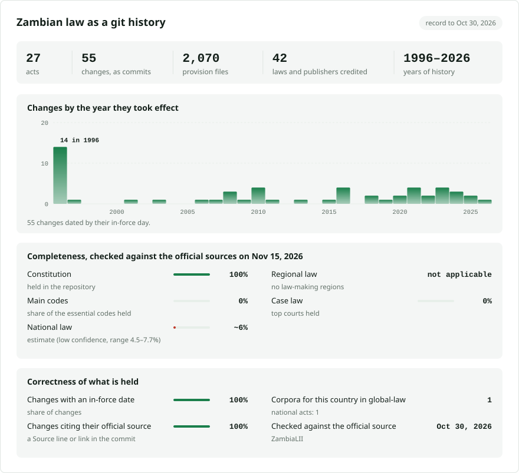

# Zambia: law history in git

<picture>
<source media="(prefers-color-scheme: dark)" srcset="data/effort-dark.svg">

</picture>

The law of Zambia as a git history: one file per section or article, one commit per version on the day it took effect, and the law that made each change as the commit's author. `git blame` names the law behind every paragraph; `git log` lists every change to a provision; picking a date gives the text in force that day.

Part of [lexifina/global-law](https://github.com/lexifina/global-law), one git history for every country's law: this is Zambia's national law, which global-law reads at `zambia/national/acts/`.

**What is in it now:** the Constitution; 144 Acts of Parliament (27 with their dated versions from ZambiaLII, the rest as passed, among them the Companies Act 2017); 45 chapters of the Laws of Zambia as consolidated in the Revised Edition, among them the Penal Code; and 134 statutory instruments and other subsidiary legislation. Also regional law binding on Zambia: 5 SADC instruments (`sadc/`) and 27 issues of the Official Gazette of COMESA (`comesa/`). See [`STRUCTURE.md`](STRUCTURE.md) for the layout and [`REPRODUCE.md`](REPRODUCE.md) for the sources.

Each act is a folder `acts/<year>/<number>-<short title>/` (chapters of the Laws of Zambia: `chapters/cap-<number>-<short title>/`; subsidiary legislation: `subsidiary/<year>/...`), with one file per section, article or schedule, plus `long-title.md` (`preamble.md` in the Acts added in November 2026) and a `README.md` listing its provisions and their changes. In `constitution/` the Constitution of Zambia Act's own sections are `sec-<number>.md` and the Constitution, its Schedule, is `art-<number>.md` (`constitution/art-047.md` is Article 47, on electoral systems).

The text is in English, as each source publishes it; for the ZambiaLII acts its editorial notes (kept only where a provision has no other text) and the Part and Chapter headings are left out.

## Questions as git commands

| Question | Command |
| --- | --- |
| Every change to Article 47 of the Constitution | `git log -p --word-diff -- constitution/art-047.md` |
| Which law wrote each line of Article 47? | `git blame constitution/art-047.md` |
| Every version of the Constitution, with the day each took effect | `git log --format="%h %(trailers:key=In-force,valueonly,separator=) %an" -- constitution ':!constitution/README.md'` |
| Article 47 as in force on 1 January 2020 | `python tools/on.py 2020-01-01 constitution art-047` |

**Outside git**, we also host this record publicly, for free:

- **[Ask Claude about Zambian law](https://global-law.lexifina.com/v1/try_claude?country=zambia)**: opens Claude with a first question ready.
- **[Ask ChatGPT](https://global-law.lexifina.com/v1/try_chatgpt?country=zambia)**: the same question in ChatGPT.
- **[Search Zambian law on our site](https://lexifina.com/law?country=zambia&q=bail)**: a search for "bail", with each provision's text and its versions, no account needed.
- **[Developer REST API](https://global-law.lexifina.com/v1/search_law?query=bail&jurisdiction=zambia)**: the same search as JSON, with no key. See the [documentation here](https://lexifina.com/api/global-law).

Both assistants read the record through the free Global law connector (MCP, `https://global-law.lexifina.com/mcp`); the first time, the chat gives you the link that adds it. Ask in English.

**Host it yourself easily.** All it takes is git and Python, and the tools run on your machine:

```sh
git clone --depth 1 https://github.com/lexifina/global-law && cd global-law
python3 tools/countries.py add zambia/national/acts
python3 tools/law.py show 2026-01-01 zambia/national/acts/constitution/art-047.md
```

Opened in Claude Code, Cursor, VS Code or Codex, the clone also starts a local MCP server with the same tools ([MCP.md](https://github.com/lexifina/global-law/blob/main/MCP.md)).

## Dates

Each commit is dated at noon, Africa/Lusaka, on the day the version took effect, and carries it in its `In-force:` trailer. The day is ZambiaLII's, the date of its point-in-time version (expression):

- for an amendment, the day it came into force, as ZambiaLII's amendment list gives it ("[Amended by <Act> on <date>]");
- for the 1996 Revised Edition of the Laws of Zambia, the first version of 14 acts, the day the edition is as at: 31 December 1996;
- for an act as enacted, its Gazette publication, or the commencement day ZambiaLII states where it gives one (the Public Procurement Act 2020, published on 23 November 2020, is dated 16 April 2021, as are six other acts by their commencement orders).

Each change is credited to the Act ZambiaLII's History names (`Act 2 of 2016`, `Act 13 of 2025`); each of the 28 amendments names one, so no change is left to the publisher. The first version of 13 acts is the act as enacted, credited to the act itself; for the other 14 it is the "oldest version available", credited to ZambiaLII.

## How it is checked

- For the 27 ZambiaLII acts (checked before their folders moved to `acts/<year>/` on 27 November 2026), `tools/check_repo.py` reads every version back from git on the day it took effect and on the day before, and compares it with the corpus: 55 versions of 27 acts, 0 mismatches (see [`REPRODUCE.md`](REPRODUCE.md)).
- Every version is parsed from an archived copy of its own dated expression page, whose sha256 is recorded with it; the newest version of each act is the one ZambiaLII's own listing named as current when it was read.
- A second build from the same corpus gave identical hashes for all 55 history commits and 96 tags.
- History is append-only: no merge commits, and nothing is rewritten. The sources added on 27 November 2026 were appended after the earlier history, so from there commit dates restart at the oldest new version; use the `In-force:` trailer (or `git log --date-order`) to read versions by date.
- [vulnerabilities/](vulnerabilities/): possible drafting mistakes in this law, found by global-law's detectors and checked by hand. Not run yet.

## What it does not show

- **Most Zambian law.** The Acts as passed come from the Ministry of Justice, the Judiciary, FAOLEX and WIPO Lex, so they are the Acts those sites hold, mostly from 1990 on, and an Act as passed is not updated by its later amendments. Not held: the Criminal Procedure Code and the Employment Code Act 2019 (the Ministry of Justice's copy no longer loads and no other open copy was found), most statutory instruments, and the National Assembly's Acts, whose use policy requires the Clerk's permission for any reproduction. Consolidated chapters with amendments after 1994 are held back: no day they are as at is printed. Case law is in a separate private repository. No OCR is used.
- **Changes before ZambiaLII's oldest version.** 14 acts, the Constitution among them, start at the 1996 Revised Edition, which already holds the earlier amendments.
- **One article across the 2016 amendment.** The Constitution of Zambia (Amendment) Act 2016 replaced most of the Constitution with new articles, and files are named by number, so on 5 January 2016 a file can change from one provision to another (`constitution/art-047.md` was on Deputy Ministers before); use `git log -p` around that day.
- **Changes within a line.** Each paragraph is one line, so blame credits a whole paragraph; use `git log -p --word-diff` for the words.

## Sources

| Source | Kind | Past versions | Notes |
| --- | --- | --- | --- |
| [ZambiaLII](https://zambialii.org) (Southern African Institute for Policy and Research, on the Laws.Africa Peachjam platform) | Legal information institute: consolidated acts | yes, each dated point-in-time version | The text, the day each version took effect, the History and amendment lists, and editorial notes naming the amending laws |
| [Internet Archive](https://web.archive.org) | Archived copies of ZambiaLII's pages (and of Ministry of Justice files that no longer load) | as archived | Every ZambiaLII page was read from an archived copy |
| [Ministry of Justice](https://www.moj.gov.zm) | Official: Acts 2018 to 2021 as passed | no | Its files return a server error; used where the Internet Archive holds a copy |
| [Judiciary of Zambia](https://judiciaryzambia.com) | Official: the court Acts and rules it publishes | no | Acts dated by the day printed under the long title, rules by their Gazette date |
| [FAOLEX](https://www.fao.org/faolex/) (FAO), listed through [ECOLEX](https://www.ecolex.org) | Secondary copy: Acts, statutory instruments and Revised Edition chapters | no | `Source-status: secondary copy`; used only where no official copy is held |
| [WIPO Lex](https://www.wipo.int/wipolex/) | Secondary copy: intellectual-property and company law, the Penal Code | no | `Source-status: secondary copy`; dates from its records |

## Licence

See [`LICENSE`](LICENSE), which lists each source's terms. The ZambiaLII texts are under CC BY-NC 4.0 with ZambiaLII credited as the source, so they may be used only for non-commercial purposes; neither ZambiaLII nor Laws.Africa endorses this repository. FAOLEX texts are reused with credit to FAO for non-commercial purposes. Lexifina's arrangement, commit messages, tables and tools are CC0 1.0.

No AI model wrote, translated or corrected legal text, and none runs at build time; the scripts were written, and the acts chosen, by an AI model (see [`REPRODUCE.md`](REPRODUCE.md)).

## Visualisations

- [visualisations/](visualisations/): charts drawn from this repository. Not drawn yet.

## More

From [lexifina/global-law](https://github.com/lexifina/global-law):

- [FEATURES.md](https://github.com/lexifina/global-law/blob/main/FEATURES.md): every feature, and what every corpus must support (`git blame`, `law.py`, the MCP tools)
- [FAQ.md](https://github.com/lexifina/global-law/blob/main/FAQ.md): questions and answers · [CONTRIBUTING.md](https://github.com/lexifina/global-law/blob/main/CONTRIBUTING.md): proposing changes · [MCP.md](https://github.com/lexifina/global-law/blob/main/MCP.md): the MCP server · [REPRODUCE.md](https://github.com/lexifina/global-law/blob/main/REPRODUCE.md): how it was built · [CHANGELOG.md](https://github.com/lexifina/global-law/blob/main/CHANGELOG.md)
- [FRESHNESS.md](https://github.com/lexifina/global-law/blob/main/FRESHNESS.md): how current each corpus is · [Monitoring](https://github.com/lexifina/global-law/tree/main/monitoring): whether updates are running · [WATCHING.md](https://github.com/lexifina/global-law/blob/main/WATCHING.md): how each official source is watched for changes
- [performance/](https://github.com/lexifina/global-law/tree/main/performance): how fast the tools are, measured
- [visualisations/](https://github.com/lexifina/global-law/tree/main/visualisations): charts and bridges across the world's law
- [Vulnerabilities](https://github.com/lexifina/global-law/tree/main/vulnerabilities): mistakes in legislation as published
